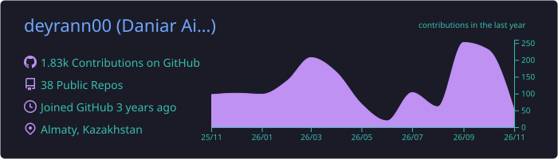
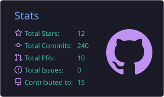
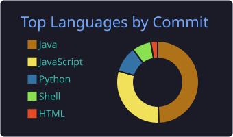
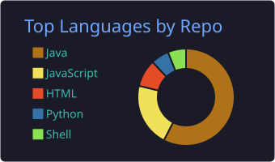
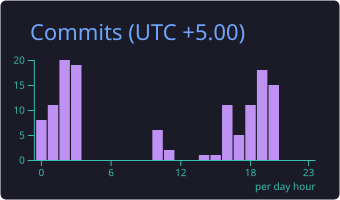

<!-- ═══════════════════════════  HEADER  ═══════════════════════════ -->
<p align="center">
  <a href="https://github.com/deyrann00">
    
  </a>
</p>

<p align="center">
  
  
  
</p>

<!-- ═══════════════════════════  PROFILE PANEL  ═══════════════════════════ -->
<table align="center">
  <tr>
    <td width="38%" align="center" valign="top">
      
      <br/>
      <sub><b>🏔️ somewhere above Almaty</b></sub>
    </td>
    <td width="62%" valign="top">

```java
public class Daniar extends Developer {

    String  location  = "Almaty, Kazakhstan 🇰🇿";
    String  role      = "Student → Backend Developer";
    String  focus     = "APIs, scrapers, automation";

    String[] backend  = { "Java", "Spring Boot", "Python", "FastAPI" };
    String[] frontend = { "JavaScript", "React", "HTML/CSS" };
    String[] data     = { "PostgreSQL", "MongoDB", "Redis" };
    String[] devops   = { "Docker", "Linux", "Bash", "Git" };

    String  learning  = "Design patterns & clean architecture";
    String  hobby     = "Hiking in the mountains ⛰️";
}
```

</td>
  </tr>
</table>

<!-- ═══════════════════════════  TECH STACK  ═══════════════════════════ -->
<h2 align="center">⚙️ Tech Stack</h2>

<p align="center">
  
  <br/>
  
</p>

<!-- ═══════════════════════════  DASHBOARD  ═══════════════════════════ -->
<h2 align="center">📊 Dashboard</h2>

<!-- Cards below are generated daily by .github/workflows/profile-cards.yml -->
<p align="center">
  
</p>

<table align="center">
  <tr>
    <td align="center"></td>
    <td align="center"></td>
  </tr>
  <tr>
    <td align="center"></td>
    <td align="center"></td>
  </tr>
</table>

<p align="center">
  
</p>

<!-- ═══════════════════════════  PROJECTS  ═══════════════════════════ -->
<h2 align="center">🚀 Featured Projects</h2>

<table align="center">
  <tr>
    <td width="50%" valign="top">
      <h3><a href="https://github.com/deyrann00/NarxozScraper">📡 NarxozScraper</a></h3>
      University monitoring: 2GIS reviews + Threads posts in one report, LLM analysis via OpenRouter, email delivery, Docker.
      <br/><br/>
      
      
      
    </td>
    <td width="50%" valign="top">
      <h3><a href="https://github.com/deyrann00/syllabus-ai-backend">🧠 Syllabus AI Backend</a></h3>
      Syllabus quality checks, approval workflow, sessions and analytics, with AI-assisted review.
      <br/><br/>
      
      
      
    </td>
  </tr>
  <tr>
    <td width="50%" valign="top">
      <h3><a href="https://github.com/deyrann00/senim-backend">🛡️ Senim Backend</a></h3>
      REST backend built on Spring Boot 3, Spring Data JPA and PostgreSQL, shipped with Docker.
      <br/><br/>
      
      
      
    </td>
    <td width="50%" valign="top">
      <h3><a href="https://github.com/deyrann00/Narxoz2GisScraper">🗺️ Narxoz2GisScraper</a></h3>
      Claude Code plugin that collects 2GIS reviews of Narxoz University branches.
      <br/><br/>
      
      
    </td>
  </tr>
  <tr>
    <td width="50%" valign="top">
      <h3><a href="https://github.com/deyrann00/SocNetScraper">🧵 SocNetScraper</a></h3>
      Daily Threads scraper for Narxoz mentions.
      <br/><br/>
      
      
    </td>
    <td width="50%" valign="top">
      <h3><a href="https://github.com/deyrann00/Expense-Tracker">💸 Expense Tracker</a></h3>
      Personal expense tracking app written in Swift.
      <br/><br/>
      
    </td>
  </tr>
</table>

<!-- ═══════════════════════════  CONTRIBUTION SNAKE  ═══════════════════════════ -->
<h2 align="center">🐍 Contribution Snake</h2>

<!-- Generated daily by .github/workflows/snake.yml into the `output` branch -->
<p align="center">
  
</p>

<!-- ═══════════════════════════  FOOTER  ═══════════════════════════ -->
<p align="center">
  
</p>
